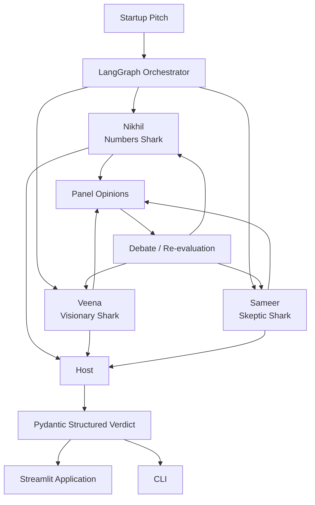

# 🦈 AI-Shark — Multi-Agent AI Investment Decision System

[](https://ai-shark-poc.streamlit.app/)
[](https://github.com/sahinulhaque/ai-shark)
[](https://www.python.org/)
[](https://www.langchain.com/langgraph)
[](https://streamlit.io/)

> **AI-Shark is a multi-agent AI system that simulates an investment panel where specialized AI agents analyze a startup from different perspectives, challenge each other's reasoning, and produce a structured final investment assessment.**

### 🚀 [Try the Live Demo](https://ai-shark-poc.streamlit.app/) · 💻 [View the Source Code](https://github.com/sahinulhaque/ai-shark)

---

## 🎯 What I Built

AI-Shark is a practical **Agentic AI proof of concept** demonstrating how multiple specialized LLM agents can collaborate on a complex decision-making problem.

Instead of asking a single LLM:

> *"Should I invest in this startup?"*

AI-Shark creates a panel of specialized AI investors. Each investor evaluates the same startup pitch from a different perspective, then the agents reconsider their positions after seeing the other viewpoints.

A final **Host agent** synthesizes the discussion into a structured investment assessment.

### The result

```text
Startup Pitch
      │
      ▼
┌───────────────────────────┐
│      LangGraph Workflow   │
└─────────────┬─────────────┘
              │
     ┌────────┼────────┐
     ▼        ▼        ▼
  Numbers  Visionary  Skeptic
     │        │        │
     └────────┼────────┘
              ▼
       Debate / Re-evaluate
              │
              ▼
            Host
              │
              ▼
      Structured Verdict
```

This demonstrates a practical approach to **multi-agent orchestration, stateful workflows, structured LLM outputs, and AI-assisted decision support**.

---

## 🦈 Meet the AI Investors

Each agent has a deliberately different responsibility.

| Agent | Role | Focus |
|---|---|---|
| **Nikhil** | Numbers Shark | Unit economics, CAC/LTV, margins, burn, valuation |
| **Veena** | Visionary Shark | Market opportunity, vision, timing, growth potential |
| **Sameer** | Skeptic Shark | Competition, defensibility, execution and risk |
| **Host** | Panel Moderator | Synthesizes the discussion and produces the final assessment |

The purpose of specialization is to reduce the tendency of every agent to provide the same generic analysis.

---

## 🧠 Agentic AI Workflow

The workflow is built around **LangGraph**.

### Step 1 — Submit a startup pitch

The user provides information about a startup, product, market, business model or investment opportunity.

### Step 2 — Independent analysis

The pitch is evaluated by the three specialized investor agents.

Each agent operates according to its own role and analytical criteria.

### Step 3 — Panel discussion

The agents' assessments are brought back into the workflow.

The agents can reconsider their analysis in light of the other perspectives.

### Step 4 — Final synthesis

The Host agent reviews the panel's reasoning and produces a consolidated assessment.

### Step 5 — Structured result

The application returns a structured verdict rather than relying only on unconstrained natural-language output.

---

## 🏗️ System Architecture



---

## 🛠️ Technology Stack

### AI & Agentic AI

- **Python**
- **LangGraph** — agent/workflow orchestration
- **LangChain Core**
- **LangChain-Groq**
- **Groq LLM API**
- Structured JSON-schema LLM responses

### Application

- **Streamlit** — interactive web interface
- Python CLI interface

### Data & Validation

- **Pydantic**
- Typed structured verdict models
- JSON-schema based output validation

### Testing

- Offline Python tests
- Persona validation
- Schema validation
- Output formatting tests
- Sample-pitch loading tests

---

## 🔐 Structured LLM Outputs

One of the important engineering aspects of AI-Shark is the use of **structured LLM responses**.

Instead of allowing the model to return arbitrary text and then attempting to parse it manually, the application defines a structured verdict schema using Pydantic.

Conceptually:

```text
                 LLM
                  │
                  ▼
          JSON Schema Output
                  │
                  ▼
        Pydantic Validation
                  │
                  ▼
          Typed Verdict
                  │
                  ▼
       Application / Streamlit
```

This provides a more predictable interface between the LLM layer and the application layer.

---

## 🧪 Testing

AI-Shark includes an offline test suite designed to validate important application behavior without requiring an LLM API call.

The tests cover areas including:

- Shark/persona definitions
- Configuration expectations
- Pydantic schema validation
- Output formatting
- Sample pitch loading

Run the offline tests with:

```bash
python test_offline.py
```

This provides a fast development feedback loop without consuming LLM API resources.

---

## 🚀 Live Demo

### [Try AI-Shark Live](https://ai-shark-poc.streamlit.app/)

The deployed Streamlit application allows you to interact with the AI investment panel and submit startup ideas for multi-agent evaluation.

**No local setup is required to explore the deployed application.**

---

## 💻 Run Locally

### 1. Clone the repository

```bash
git clone https://github.com/sahinulhaque/ai-shark.git
cd ai-shark
```

### 2. Create a virtual environment

Linux/macOS:

```bash
python -m venv .venv
source .venv/bin/activate
```

Windows:

```powershell
python -m venv .venv
.venv\Scripts\activate
```

### 3. Install dependencies

```bash
pip install -r requirements.txt
```

### 4. Configure the Groq API key

Set your Groq API key as an environment variable.

Linux/macOS:

```bash
export GROQ_API_KEY="your-api-key"
```

Windows PowerShell:

```powershell
$env:GROQ_API_KEY="your-api-key"
```

> **Security:** Never commit API keys, passwords, tokens, or other credentials to GitHub.

### 5. Start the application

```bash
streamlit run app.py
```

Open the local Streamlit URL displayed in your terminal.

---

## 📁 Project Structure

The project separates the main responsibilities of the application into focused Python modules.

```text
ai-shark/
│
├── app.py              # Streamlit application
├── run.py              # CLI entry point
├── sharks.py           # Shark personas / agent definitions
├── panel.py            # Panel orchestration and LLM interaction
├── schema.py           # Pydantic structured verdict models
├── test_offline.py     # Offline test suite
├── requirements.txt    # Project dependencies
│
└── ...
```

This separation allows the agent definitions, orchestration logic, data models and presentation layer to evolve independently.

---

## 💡 Why This Architecture Is Useful

The architecture demonstrated by AI-Shark is not limited to startup investment analysis.

The same multi-agent pattern can be adapted to many business applications.

### 🤖 Customer Support

Specialized agents can handle:

- Intent classification
- Knowledge retrieval
- Technical troubleshooting
- Escalation analysis
- Final response generation

### 📊 Business Decision Support

Different agents can independently evaluate:

- Financial considerations
- Market conditions
- Operational risks
- Strategic opportunities

A synthesis agent can then produce a consolidated recommendation.

### 🔬 Research Assistants

Multiple agents can investigate different aspects of a research question and a final agent can synthesize the findings.

### 💼 Sales & Lead Qualification

Agents can separately evaluate:

- Customer fit
- Commercial potential
- Buying signals
- Risk
- Recommended next action

### ⚠️ Risk Analysis

Multiple analytical perspectives can be combined before producing a structured risk assessment.

---

## 📌 Key Engineering Concepts Demonstrated

### Agentic AI

- Multi-agent collaboration
- Specialized agent roles
- Independent reasoning
- Agent-to-agent discussion
- Re-evaluation
- Final synthesis

### Workflow Orchestration

- LangGraph-based workflow
- Explicit state transitions
- Specialized processing nodes
- Separation of agent responsibilities

### LLM Engineering

- Prompt/persona design
- Structured LLM responses
- JSON-schema constrained output
- Pydantic validation
- LLM application integration

### Software Engineering

- Modular Python architecture
- CLI + web interface
- Environment-based configuration
- Offline testing
- Dependency management

---

## 🎯 What This Project Demonstrates

AI-Shark demonstrates practical experience building an **Agentic AI application from the orchestration layer to the user interface**.

```text
Python
  │
  ├── LangGraph
  │     └── Multi-Agent Orchestration
  │
  ├── LLM Engineering
  │     ├── Specialized Prompts
  │     ├── Structured Outputs
  │     └── JSON Schema
  │
  ├── Pydantic
  │     └── Typed Validation
  │
  ├── Streamlit
  │     └── Interactive AI Application
  │
  └── Testing
        └── Offline Validation
```

---

## 💼 Why I Built This POC

AI-Shark was built to explore a practical question:

> **Can multiple specialized AI agents provide a more useful decision-support workflow than a single general-purpose LLM response?**

The project demonstrates one possible architecture for solving that problem through:

**specialization → independent analysis → discussion → re-evaluation → synthesis → structured output**

This pattern can be adapted to many real-world AI automation and decision-support systems.

---

## 👨‍💻 About the Developer

### Sahinul Haque

**AI & Agentic AI Developer | Technical Architect**

I build practical AI and software systems using technologies such as:

- Python
- LangGraph
- LangChain
- RAG
- LLMs
- FastAPI
- Agentic AI workflows
- Full-stack application development

My focus is on turning AI concepts into **structured, maintainable and demonstrable software applications**.

AI-Shark is one of my AI proof-of-concept projects demonstrating multi-agent orchestration, structured LLM interaction and AI-assisted decision workflows.

---

## 🔗 Project Links

| Resource | Link |
|---|---|
| 🚀 **Live Demo** | [ai-shark-poc.streamlit.app](https://ai-shark-poc.streamlit.app/) |
| 💻 **GitHub Repository** | [github.com/sahinulhaque/ai-shark](https://github.com/sahinulhaque/ai-shark) |

---

## 📈 Skills Demonstrated

**Agentic AI · Multi-Agent Systems · LangGraph · LangChain · Python · LLM Applications · Groq · Pydantic · Structured Outputs · JSON Schema · Streamlit · AI Workflow Orchestration · Prompt Engineering · Software Testing**

---


> **AI-Shark demonstrates how specialized AI agents can analyze a problem from different perspectives, challenge assumptions, and produce a structured decision-support result.**
